<div align="center">

# ⚔️ Realm Raiders

### An Android island-raid strategy game where every raid is provable on Monad

Build a castle, raise a 3D General, raid rival islands — and let five AI officers defend your realm while you sleep.<br/>
Every base, battle seed and result is committed to the **Monad testnet**, so anyone can re-run a raid and prove it was fair.

<p>
  
  
  
  
  
</p>

<!-- 🎬 DEMO VIDEO: replace YOUR_VIDEO_ID in the link below with your YouTube video id
     (the part after "watch?v=" in the YouTube URL). -->
<a href="https://www.youtube.com/watch?v=7rWs0VE33_I" target="_blank" rel="noopener noreferrer" title="Watch the Realm Raiders demo on YouTube">
  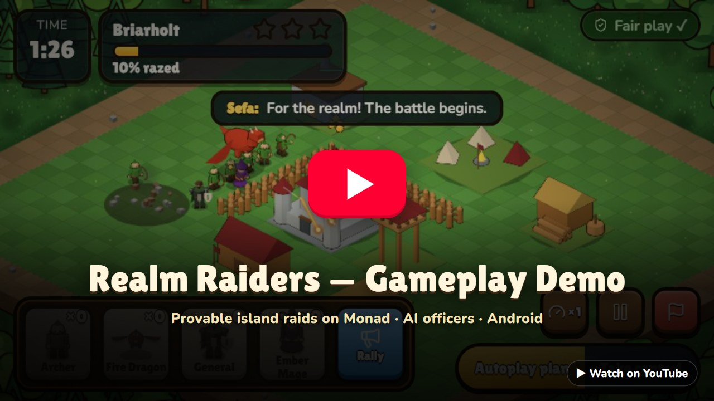
</a>

<sub>▶️ <b>Click the video to watch the full demo on YouTube</b></sub>

<br/><br/>

[Features](#-features) · [Screenshots](#-screenshots) · [How a raid is proven](#-how-a-raid-is-proven) · [Architecture](#%EF%B8%8F-architecture) · [Contracts](#%EF%B8%8F-smart-contracts) · [Quick start](#-quick-start) · [Testing](#-testing--verification)

</div>

---

## 🏝️ What is Realm Raiders?

Realm Raiders is set in the **Emberwake Isles**, an original world of storm-cut islands left behind when a sky-dragon fell and broke the old continent. Every lord wants **ember**, the glowing stuff that washes up on the shores.

You are a lord with one island. **By day** you build and raid. **At night** you seal orders and go to sleep, and your AI officers defend the island within those orders. **In the morning** you read what happened.

The twist: **gameplay stays fast and off-chain, but the commitments live on Monad.** Your base layout is sealed before anyone raids it, the battle seed is fixed by a commit–reveal before the first tick, and the result commits the replay hash. The battle engine is deterministic, so the server — or anyone else — can re-simulate a raid and catch a faked result.

> **No crypto knowledge needed.** Players sign in with Google or email (Privy embedded wallet) or as a Guest. A relayer pays the gas; players just see a `Monad ✓` chip that opens the explorer.

---

## ✨ Features

| | Feature | What it means |
|---|---|---|
| 🔒 | **Provably fair raids** | Base hash sealed on chain → seed locked by commit–reveal → replay re-simulated → result + replay hash recorded. Anyone can verify. |
| 🧠 | **Five AI officers** | General, Architect, Strategist, Night Captain and Intelligence Officer. They plan raids by *actually simulating them*, check your walls and write your reports — and every answer is checked against real game facts, falling back to built-in rules within 4 s. |
| 🌙 | **Night Captain** | Seal tonight's orders on chain; rival lords raid you overnight and your officers defend *only within those orders*. Read the Morning Report. |
| 🤖 | **Auto Mode** | Let the officers collect, build, re-seal and raid for you under sealed **Auto Orders**. Every move is checked and logged on chain with `logAutopilot`; refused moves are explained. |
| 🤝 | **Play with Friends** | Host a room on the Wi-Fi, raid a friend while they watch live, or fight a **Live Duel** on one shared seed — recorded on `RealmDuels`. |
| 🪪 | **On-chain identity** | Each General is registered as an **ERC-8004 agent** with on-chain reputation; achievements are **soulbound ERC-1155 badges**. |
| 📴 | **Works offline** | With no server in reach, the whole realm runs on the phone against a mock ledger. |
| 🎨 | **100 % original** | Every troop, building, sound and music track is generated in code — no downloaded art packs. |

**The realm:** 14 buildings (Citadel, Goldworks, Lumber Camp, Ember Well, Bowyer Tower, Stonethrower, Rune Obelisk, Wyrm Ballista, walls, traps…), 7 troops (Swordsman, Archer, Sapper, Stone Giant, Ember Mage, Fire Dragon and your General with a Rally power), 3 rival islands (Briarholt, Kragmoor Deep, Saltspire Eyrie), ranks from Squire to High Marshal, and Gems that can only be earned by playing.

---

## 📸 Screenshots

<table>
  <tr>
    <td align="center">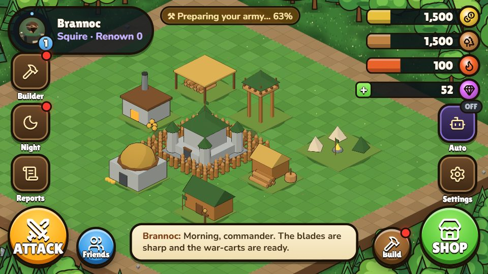<br/><sub><b>Your island</b> — resources, advisers, Auto and the Shop</sub></td>
    <td align="center">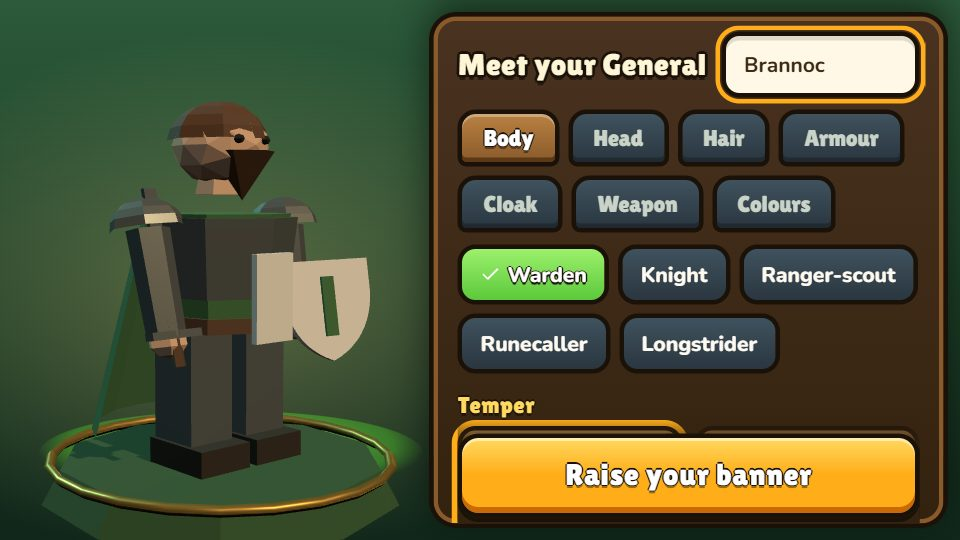<br/><sub><b>Raise your General</b> — a 3D hero and an ERC-8004 agent</sub></td>
  </tr>
  <tr>
    <td align="center">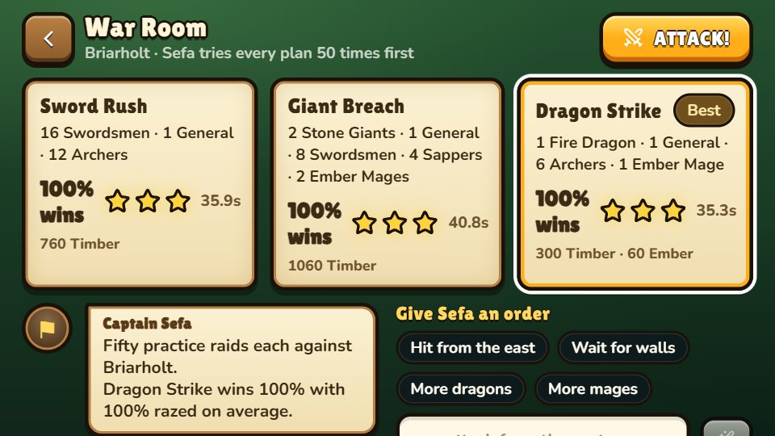<br/><sub><b>War Room</b> — the Strategist simulates every plan</sub></td>
    <td align="center">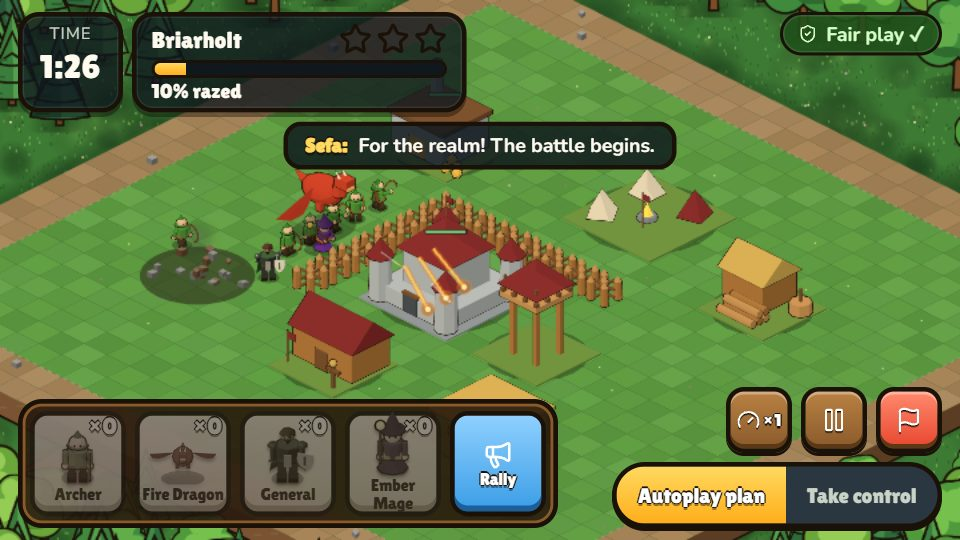<br/><sub><b>Battle</b> — seed locked on chain before tick 0</sub></td>
  </tr>
  <tr>
    <td align="center">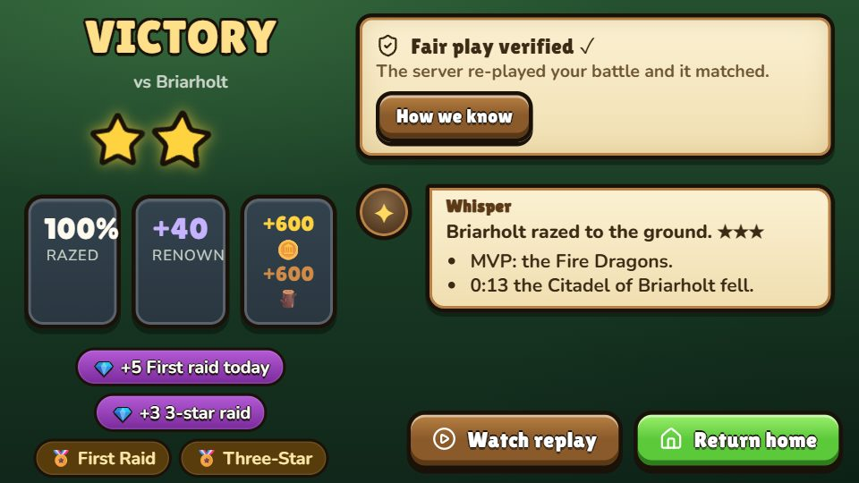<br/><sub><b>Result</b> — "Fair play verified ✓" and how we know</sub></td>
    <td align="center">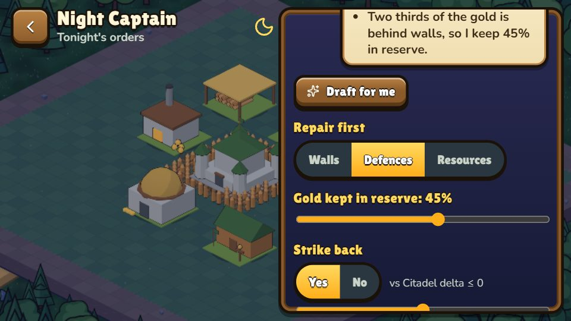<br/><sub><b>Night Captain</b> — orders sealed before you sleep</sub></td>
  </tr>
  <tr>
    <td align="center">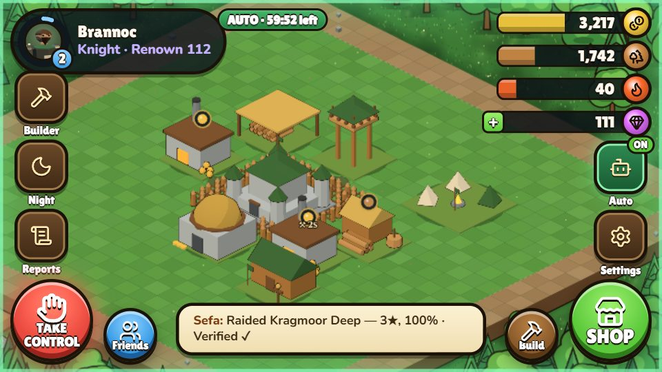<br/><sub><b>Auto Mode</b> — officers play inside your orders</sub></td>
    <td align="center">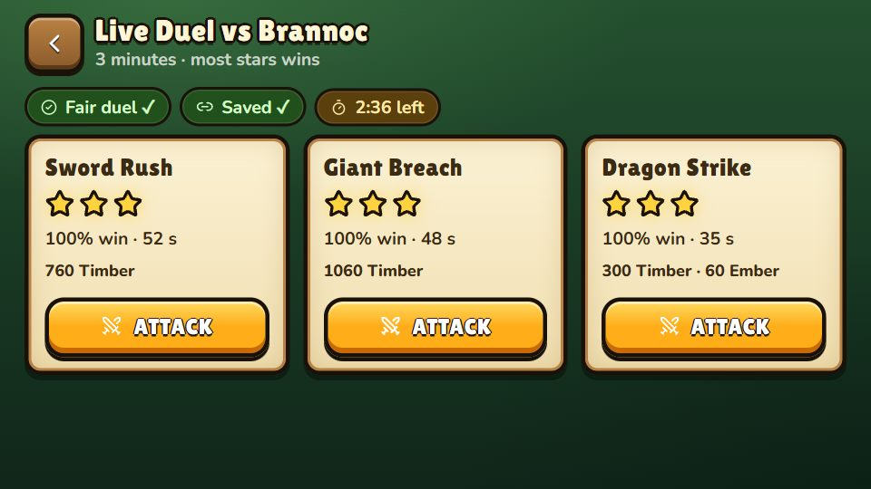<br/><sub><b>Live Duel</b> — one shared seed, both replays verified</sub></td>
  </tr>
</table>

More in [`docs/screens/`](docs/screens) and the full illustrated report: [`docs/Realm-Raiders-Explained.pdf`](docs/Realm-Raiders-Explained.pdf).

---

## 🔐 How a raid is proven

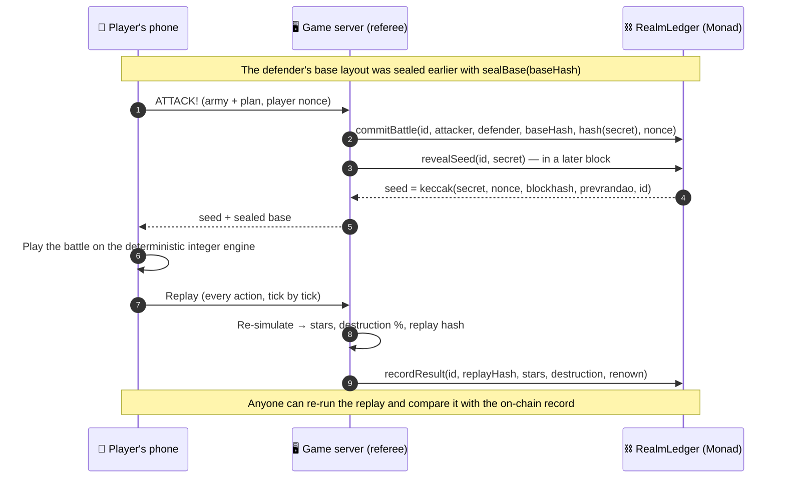

- **Neither side picks the seed alone:** the server commits a secret, the player contributes a nonce, and the chain mixes in block data at reveal time.
- **The defender can't be swapped:** `commitBattle` reverts unless the base hash matches the defender's sealed layout.
- **The result is checkable:** `resultHashOf(battleId)` on chain equals the off-chain result hash; `pnpm verify-replay <battleId> --chain` re-checks any raid.
- **AI acts only inside sealed orders:** every autopilot action carries the policy hash sealed with `commitPolicy`; anything else reverts.

---

## 🏗️ Architecture

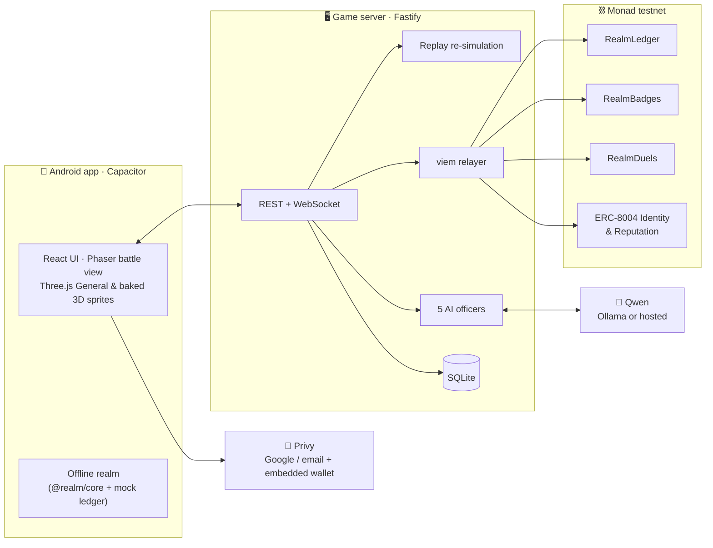

The key design idea: **the same game code runs on the phone and on the server.** `packages/game-data` (every number), `packages/battle-engine` (deterministic integer rules + replays), `packages/shared` (schemas, hashes, ABIs) and `packages/core` (game services) are built into both — so they always agree, and the phone can play the whole game offline.

---

## ⛓️ Smart contracts

Deployed on **Monad testnet (chain ID 10143)** and source-verified on Sourcify (exact match), visible on [MonadVision](https://testnet.monadvision.com).

| Contract | Address | Purpose |
|---|---|---|
| **RealmLedger** | [`0x3531C4198f0f5b97f356C4fF1f785f7A5A284c8F`](https://testnet.monadvision.com/address/0x3531C4198f0f5b97f356C4fF1f785f7A5A284c8F) | Base seals, commit–reveal battle seeds, verified results, Renown, night & Auto orders, autopilot log (with EIP-712 relayed signatures) |
| **RealmBadges** | [`0xE94E902361906451247f0d00692d38D337068Ebb`](https://testnet.monadvision.com/address/0xE94E902361906451247f0d00692d38D337068Ebb) | Soulbound ERC-1155 achievements: First Seal, First Raid, Three-Star, Night Watch, Architect's Pupil |
| **RealmDuels** | [`0xF6F788A880F3519939e6E8864090Fe6C2CEb13Dc`](https://testnet.monadvision.com/address/0xF6F788A880F3519939e6E8864090Fe6C2CEb13Dc) | Live Duel results — both replay hashes and the winner |
| **ClanSiege** | [`0x2dD91f2F4e5A25586f168a2422Ba1F6a66451311`](https://testnet.monadvision.com/address/0x2dD91f2F4e5A25586f168a2422Ba1F6a66451311) | Boss-siege tap log (deployed; not used by the current game build) |
| ERC-8004 Identity | [`0x8004A818BFB912233c491871b3d84c89A494BD9e`](https://testnet.monadvision.com/address/0x8004A818BFB912233c491871b3d84c89A494BD9e) | Canonical registry — each General's agent card |
| ERC-8004 Reputation | [`0x8004B663056A597Dffe9eCcC1965A193B7388713`](https://testnet.monadvision.com/address/0x8004B663056A597Dffe9eCcC1965A193B7388713) | Canonical registry — on-chain feedback after each verified raid |
| Relayer / referee | `0xd32B2e51F423A1A260a00Dc52C1b3e8af97cAf27` | Admin, `RELAYER_ROLE` and `MINTER_ROLE`; pays players' gas |

Contracts use OpenZeppelin 5.6.1 `AccessControl`, `EIP712` and `ECDSA`; sources are in [`contracts/src`](contracts/src). Addresses are read by the server and the app from [`packages/shared/src/deployments.json`](packages/shared/src/deployments.json).

---

## 🧰 Tech stack

| Layer | Technology |
|---|---|
| **App** | React 19 · Phaser 4 · Three.js · Vite 8 · Capacitor 8 (Android) |
| **Auth & wallet** | Privy (Google / email, embedded EVM wallet) · Guest mode |
| **Server** | Node.js 22 · Fastify 5 · WebSocket · SQLite (better-sqlite3 + Drizzle) · jose |
| **Chain** | Solidity 0.8.38 · OpenZeppelin 5.6.1 · viem 2 · Monad testnet · ERC-8004 · Sourcify |
| **AI officers** | Qwen3 via Ollama (local) or any OpenAI-compatible host, with rule-based fallbacks |
| **Testing** | Vitest · in-process EVM (@ethereumjs/vm) · Playwright · Foundry tests (optional) |
| **Tooling** | TypeScript 6 · pnpm 10 workspaces |

---

## 📂 Repository layout

```text
.
├── apps/
│   ├── client/          # React + Phaser + Three.js game, Capacitor Android project (screens 01–17)
│   ├── server/          # Fastify API, WebSocket hub, AI officers, replay referee, viem relayer
│   └── landing/         # Landing site, /.well-known/assetlinks.json and the OAuth /redirect page
├── packages/
│   ├── game-data/       # Every number in the game (stats, costs, economy, ranks, badges, rivals)
│   ├── battle-engine/   # Deterministic integer battle rules, replays, replay hash, verifier
│   ├── shared/          # API schemas, base hashing, contract ABIs, chain config, deployments.json
│   └── core/            # Game services shared by the server and the in-app offline realm
├── contracts/           # Solidity sources, solc-js build, in-process EVM tests, viem deploy + verify
├── tools/               # verify-replay, live-run (end-to-end on-chain run), balance tools
├── docs/                # Screenshots, explainer report (PDF) and its sources
└── scripts/             # APK build helpers, originality check, screenshot capture
```

---

## 🚀 Quick start

### Prerequisites

- **Node.js ≥ 22.12** and **pnpm 10** (`corepack enable`)
- Optional: **Android Studio** (SDK + JDK) to build the APK
- Optional: **[Ollama](https://ollama.com)** for live AI officers (`ollama pull qwen3:4b`)
- Optional: testnet **MON** from the [Monad faucet](https://faucet.monad.xyz) for live-chain mode

### 1 · Install

```bash
git clone https://github.com/AREEB-08/Realm-Raiders.git
cd Realm-Raiders
pnpm install
```

### 2 · Play

| Command | What you get |
|---|---|
| `pnpm dev:local` | The app only — the whole realm runs in the browser on a mock ledger → <http://localhost:5173> |
| `pnpm dev` | App + API server on `:8787` (mock chain unless `CHAIN_MODE=live`) |
| `pnpm dev:lan` | Hosts a **Play with Friends** room that phones on the same Wi-Fi can find |

> 💡 The game is played in **landscape**. In a desktop browser, use a wide window or the device toolbar.

### 3 · Configure (optional, for live features)

Copy the templates and fill in what you need — every `.env` file is gitignored:

```bash
cp apps/server/.env.example apps/server/.env     # SECRET: relayer key, Privy secret, LLM keys
cp apps/client/.env.example apps/client/.env     # PUBLIC: every VITE_* value ships inside the APK
cp contracts/.env.example   contracts/.env       # deploy settings (relayer address, badge URI)
```

| Variable | Where | Purpose |
|---|---|---|
| `CHAIN_MODE` | server | `live` (Monad testnet) or `mock` |
| `RELAYER_PRIVATE_KEY` | server | Funded testnet wallet that pays gas and holds the relayer roles |
| `PRIVY_APP_ID` / `PRIVY_APP_SECRET` | server | Verify Privy logins and look up the player's embedded wallet |
| `SESSION_JWT_SECRET` | server | 32+ random bytes for game session tokens |
| `AGENTS_MODE`, `LLM_*` | server | `live` officers through Ollama / a hosted model, or `offline` rules |
| `VITE_PRIVY_APP_ID` | client | Enables Google / email sign-in |
| `VITE_API_URL` | client | Comma-separated server URLs, tried in order (e.g. `http://localhost:8787,http://10.0.2.2:8787`) |
| `VITE_BACKEND` | client | `auto` (server if it answers, else offline realm), `remote` or `local` |

### 4 · Run on the live Monad testnet

```bash
# apps/server/.env → CHAIN_MODE=live and a funded RELAYER_PRIVATE_KEY
pnpm --filter @realm/server start      # live server on :8787
pnpm tsx tools/live-run.ts             # plays every on-chain moment through the API and prints explorer links
```

`GET http://localhost:8787/health` shows the chain mode, latest block and relayer balance.

### 🔑 Google / email sign-in (Privy)

1. Create an app at [dashboard.privy.io](https://dashboard.privy.io).
2. **Login methods:** enable **Email** and **Google**.
3. **Embedded wallets:** enable EVM wallets, created on login for users without a wallet.
4. **Allowed origins:** `http://localhost:5173` (browser) and `https://localhost` (the Android WebView).
5. **OAuth redirect URL (APK):** `https://<VITE_LANDING_HOST>/redirect` — deploy `apps/landing` there so its `/.well-known/assetlinks.json` lets Google return to the app.
6. Optional: **gas sponsorship** for Monad testnet. Without it, every player action falls back to the relayer automatically.
7. Set `PRIVY_APP_ID` + `PRIVY_APP_SECRET` (server) and `VITE_PRIVY_APP_ID` (client).

Until Privy is configured, **Guest commander** sign-in is used.

### 🧠 Live AI officers

```bash
ollama serve                 # with qwen3:4b pulled
# apps/server/.env → AGENTS_MODE=live, LLM_LOCAL_BASE_URL=http://localhost:11434/v1, LLM_LOCAL_MODEL=qwen3:4b
```

A hosted OpenAI-compatible endpoint (`LLM_BASE_URL` / `LLM_API_KEY`, with `LLM_FALLBACK_*`) is tried first when set. Every officer falls back to its rule-based "field manual" after 4 s, on invalid JSON, or when an answer quotes a number that is not in its facts.

### 📱 Android

```bash
pnpm apk            # web build → cap sync → debug APK in apps/client/android/app/build/outputs/apk/debug/
pnpm apk:release    # signed release APK (needs apps/client/android/keystore.properties — gitignored)
```

- **Offline (any phone):** install the APK; with no server in reach the whole realm runs on the phone.
- **Live (same Wi-Fi):** start the server, allow Node through the firewall on port 8787, and put your PC's LAN IP in `VITE_API_URL` before building. The emulator reaches the PC at `http://10.0.2.2:8787`.
- **Release builds** need an HTTPS server URL, e.g. `cloudflared tunnel --url http://localhost:8787`.

---

## 🧪 Testing & verification

```bash
pnpm -r typecheck                 # every package + a solc compile of the contracts
pnpm -r test                      # engine, game data, core, server, client and contracts (on an in-process EVM)
pnpm e2e                          # Playwright play-throughs in Chrome
pnpm check:originality            # guards against non-original names and assets
pnpm digest                       # 200-seed determinism digest (must match the phone's /dev/sim)

pnpm verify-replay packages/battle-engine/fixtures/golden-1.rrpl            # → OK, 3★ 100%
pnpm verify-replay <battleId> --api http://localhost:8787 --chain           # re-check a live raid against RealmLedger
```

### Deploying the contracts

```bash
pnpm --filter @realm/contracts run build     # solc 0.8.38, optimizer 2000 runs, evm prague
pnpm --filter @realm/contracts test          # 9 contract tests on an in-process EVM
pnpm --filter @realm/contracts run deploy    # Monad testnet only (refuses any other chain)
pnpm --filter @realm/contracts run verify    # Sourcify / MonadVision
```

`deploy` writes `contracts/deployments/10143.json` and refreshes `packages/shared/src/deployments.json`, which the server and the app read. Foundry is optional: after `forge install foundry-rs/forge-std OpenZeppelin/openzeppelin-contracts@v5.6.1 --no-git` in `contracts/`, `forge test` runs `test/RealmLedger.t.sol`.

---

## 📚 More documentation

- [`docs/Realm-Raiders-Explained.pdf`](docs/Realm-Raiders-Explained.pdf) — the illustrated project report: architecture, battle engine, proofs, officers, every screen
- [`DEMO.md`](DEMO.md) — the live-demo run sheet and fallback plan
- [`assets/CREDITS.md`](assets/CREDITS.md) and [`LICENSES/README.md`](LICENSES/README.md) — credits and licences

## 📄 License

Realm Raiders' source, world, names, art and audio are **all rights reserved** by the project owner unless stated otherwise — see [`LICENSES/README.md`](LICENSES/README.md). Third-party components keep their own licences (OpenZeppelin Contracts — MIT; Phaser, Three.js, React, viem — MIT; fonts — SIL OFL 1.1; Lucide icons — ISC).

<div align="center">
<br/>
<sub>Built on <b>Monad</b> · Every raid provable · No wallet popups</sub>
</div>
